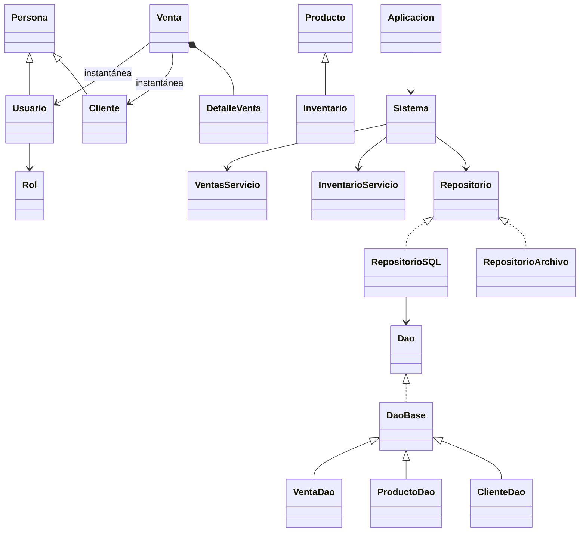
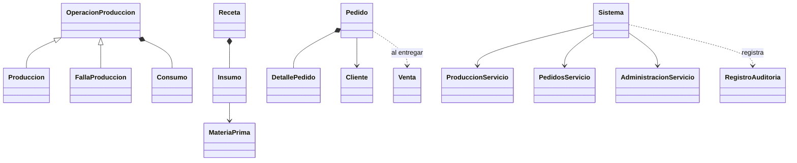

# Diseño orientado a objetos

## Responsabilidades

| Capa | Clases | Responsabilidad |
|---|---|---|
| Entrada | ProyectoFina | Arranque, bloqueo de instancia y manejo de error inicial. |
| Presentación | Aplicacion, Gui y los diez paneles de trabajo | Navegación, formularios, tablas, mensajes y eventos Swing. Sin lectura directa de los archivos de estado. |
| Aplicación | Sistema | Sesión y permisos; transacción sobre copia del estado. |
| Servicios | InventarioServicio, ProduccionServicio, PedidosServicio, ClientesServicio, VentasServicio, UsuariosServicio, ReportesServicio, AdministracionServicio | Reglas de negocio y operaciones del caso de uso. |
| Dominio | Persona, Cliente, Usuario, Rol, Producto, Inventario, Venta, DetalleVenta | Datos y comportamiento del negocio. |
| Persistencia | Repositorio, RepositorioArchivo, Estado | Contrato de lectura/guardado, importación inicial y reemplazo atómico. |
| Acceso a datos (EF) | ConexionBD, Dao<T>, DaoBase<T>, RolDao, UsuarioDao, ClienteDao, ProductoDao, VentaDao, MateriaPrimaDao, RecetaDao, PedidoDao, OperacionProduccionDao, MovimientoDao, HistorialDao, RepositorioSQL | CRUD con JDBC sobre MySQL (XAMPP); `RepositorioSQL` implementa `Repositorio` y guarda todo en una transacción con rollback. |
| Exportación | Comprobante, Reporte, ArchivoPDF | Construcción y escritura de comprobantes y reportes. |

## Relaciones justificadas

- **Herencia:** Cliente y Usuario son personas. Persona concentra identidad y datos comunes; cada hija sobrescribe `mostrarPersona()`. PA33 invoca el método a través de `List<Persona>` y comprueba el comportamiento de cada subtipo.
- **Especialización:** Inventario representa un producto con existencias y extiende Producto. No es el almacén completo. La lista de existencias pertenece a Estado. Se conserva el nombre del diagrama de clases del S09.
- **Composición:** Venta posee una lista de DetalleVenta; cada detalle conserva producto, cantidad y precio al vender. Se reemplazaron las tres listas paralelas por una colección única. El detalle devuelve una copia del producto.
- **Asociación:** Usuario tiene un Rol; Venta conserva instantáneas del cliente y vendedor. Reporte consulta colecciones del estado.
- **Interfaz y polimorfismo:** Sistema depende de Repositorio. RepositorioSQL (MySQL) es la implementación principal y RepositorioArchivo la alternativa sin base de datos; las pruebas sustituyen el repositorio por uno que falla para demostrar que no queda una venta parcialmente registrada.
- **Encapsulamiento:** los campos de las entidades son privados. Los servicios reciben parámetros validados. `Sistema.consultar()` entrega una copia profunda; modificar esa copia no modifica el sistema (PA25). Estado expone sus colecciones únicamente como estructura interna de persistencia y transacción.

## Flujo de una venta

1. VentasPanel acumula cantidades en el carrito sin cambiar existencias.
2. La confirmación llama VentasServicio; Sistema exige permiso VENTAS.
3. Se copia Estado y se verifica cada producto/cantidad de nuevo.
4. En la copia se crean Venta y DetalleVenta, se actualizan existencias y se registran movimientos.
5. RepositorioSQL guarda los cambios en MySQL dentro de una transacción JDBC (`commit`; ante un error, `rollback`). Si falla, Sistema mantiene el estado anterior y la UI muestra el error. En modo archivo, RepositorioArchivo escribe un temporal y reemplaza el archivo final con movimiento atómico.
6. Solo después del guardado se vacía el carrito. El PDF se genera después; si falla se informa que la venta ya quedó registrada y puede regenerarse desde Historial.

PA28 comprueba rechazo sin descuento parcial; PA29 simula fallo de disco durante la venta. PA11/PA15 prueban que una modificación del catálogo no cambia el comprobante histórico.

## Decisiones y límites

Se usa Java 17, la biblioteca estándar y el driver MySQL Connector/J incluido en `lib/`, para abrir el proyecto en NetBeans sin descargar dependencias. Las pruebas se ejecutaron con Java 24 y compilación `--release 17`; no se ejecutó un segundo sistema operativo ni una JVM 17 instalada. El modo archivo usa un formato serializado local a esta versión: futuros cambios de esquema requieren migración. Las credenciales y los datos de ejemplo son para un proyecto académico, no un servicio desplegado en producción. La importación de CSV es local y síncrona; el volumen de datos del taller es pequeño.

## Ampliación de la Evaluación Final

- **Herencia (nueva):** `OperacionProduccion` es abstracta; `Produccion` y `FallaProduccion` la extienden y sobrescriben `getTipo()`, `calcularCostoTotal()` y `describir()`. El historial del taller recorre una sola `List<OperacionProduccion>` y cada objeto responde según su clase (polimorfismo). En la BD se guardan en una sola tabla `operaciones_produccion` con la columna `tipo`; `OperacionProduccionDao` crea la subclase correcta al leer.
- **Composición (nueva):** `Receta` posee sus `Insumo`; `Pedido` posee sus `DetallePedido`; cada `OperacionProduccion` posee sus `Consumo` de materia prima. En la BD, `detalle_pedido` y `consumos_materia` se borran en cascada con su dueño.
- **Asociación:** `Receta` → `MateriaPrima` (por código); `Pedido` → `Cliente`; `Pedido` → `Venta` cuando se entrega.
- **Interfaz y genéricos:** `Dao<T>` define el CRUD y trae el método por defecto `sincronizar()`; `DaoBase<T>` (abstracta) implementa listar/buscar/eliminar; cada DAO concreto solo define cómo leer y escribir su fila. `Repositorio` tiene tres implementaciones: `RepositorioSQL`, `RepositorioArchivo` y el repositorio en memoria de `PruebasEF`.
- **Encapsulamiento y validación:** `MateriaPrima.descontar()` no deja stock negativo; `Venta.aplicarDescuento()` limita a 30 %; `Pedido` controla sus cambios de estado (no se entrega sin calidad aprobada); `Cliente.setCategoria()` solo acepta las categorías definidas.
- **Auditoría transversal:** `Sistema.cambiar(permiso, acción, detalle, operación)` es el único punto por donde se modifican datos: verifica permiso, trabaja sobre una copia, agrega el `RegistroAuditoria` y guarda todo en una transacción.
- **Stock comprometido:** `Estado.stockComprometido()` suma los pedidos activos; `stockDisponible()` = stock − comprometido. Ventas y pedidos usan estos métodos, así no se vende lo reservado.

