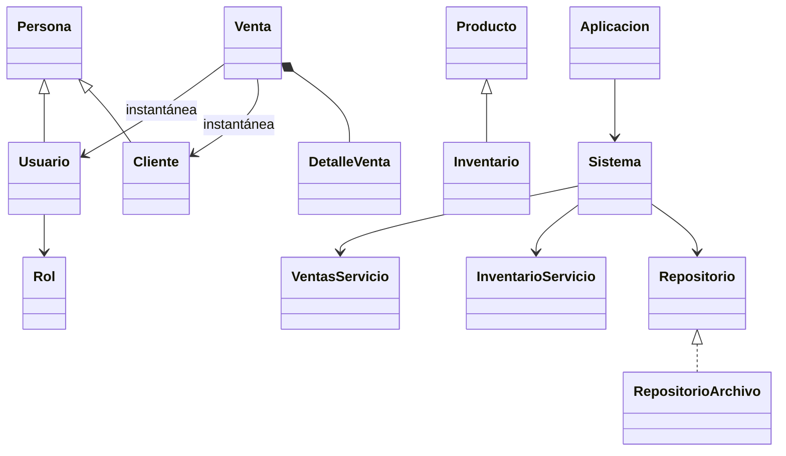

# Diseño orientado a objetos

## Responsabilidades

| Capa | Clases | Responsabilidad |
|---|---|---|
| Entrada | ProyectoFina | Arranque, bloqueo de instancia y manejo de error inicial. |
| Presentación | Aplicacion, Gui y los seis paneles de trabajo | Navegación, formularios, tablas, mensajes y eventos Swing. Sin lectura directa de los archivos de estado. |
| Aplicación | Sistema | Sesión y permisos; transacción sobre copia del estado. |
| Servicios | InventarioServicio, ClientesServicio, VentasServicio, UsuariosServicio, ReportesServicio | Reglas de negocio y operaciones del caso de uso. |
| Dominio | Persona, Cliente, Usuario, Rol, Producto, Inventario, Venta, DetalleVenta | Datos y comportamiento del negocio. |
| Persistencia | Repositorio, RepositorioArchivo, Estado | Contrato de lectura/guardado, importación inicial y reemplazo atómico. |
| Exportación | Comprobante, Reporte, ArchivoPDF | Construcción y escritura de comprobantes y reportes. |

## Relaciones justificadas

- **Herencia:** Cliente y Usuario son personas. Persona concentra identidad y datos comunes; cada hija sobrescribe `mostrarPersona()`. PA33 invoca el método a través de `List<Persona>` y comprueba el comportamiento de cada subtipo.
- **Especialización:** Inventario representa un producto con existencias y extiende Producto. No es el almacén completo. La lista de existencias pertenece a Estado. Se conserva este nombre para facilitar la comparación con el proyecto entregado.
- **Composición:** Venta posee una lista de DetalleVenta; cada detalle conserva producto, cantidad y precio al vender. Se reemplazaron las tres listas paralelas por una colección única. El detalle devuelve una copia del producto.
- **Asociación:** Usuario tiene un Rol; Venta conserva instantáneas del cliente y vendedor. Reporte consulta colecciones del estado.
- **Interfaz y polimorfismo:** Sistema depende de Repositorio. RepositorioArchivo es la implementación real; las pruebas sustituyen el repositorio por uno que falla para demostrar que no queda una venta parcialmente registrada.
- **Encapsulamiento:** los campos de las entidades son privados. Los servicios reciben parámetros validados. `Sistema.consultar()` entrega una copia profunda; modificar esa copia no modifica el sistema (PA25). Estado expone sus colecciones únicamente como estructura interna de persistencia y transacción.

## Flujo de una venta

1. VentasPanel acumula cantidades en el carrito sin cambiar existencias.
2. La confirmación llama VentasServicio; Sistema exige permiso VENTAS.
3. Se copia Estado y se verifica cada producto/cantidad de nuevo.
4. En la copia se crean Venta y DetalleVenta, se actualizan existencias y se registran movimientos.
5. RepositorioArchivo escribe un temporal y reemplaza el archivo final con movimiento atómico. Si falla, Sistema mantiene el estado anterior y la UI muestra el error.
6. Solo después del guardado se vacía el carrito. El PDF se genera después; si falla se informa que la venta ya quedó registrada y puede regenerarse desde Historial.

PA28 comprueba rechazo sin descuento parcial; PA29 simula fallo de disco durante la venta. PA11/PA15 prueban que una modificación del catálogo no cambia el comprobante histórico.

## Decisiones y límites

Se usa Java 17 y biblioteca estándar para abrir el proyecto en NetBeans sin descargar dependencias. Las pruebas se ejecutaron con Java 24 y compilación `--release 17`; no se ejecutó un segundo sistema operativo ni una JVM 17 instalada. El formato serializado es local a esta versión: futuros cambios de esquema requieren migración. Las credenciales y los datos de ejemplo son para un proyecto académico, no un servicio desplegado en producción. El trabajo de archivo es local y síncrono; el volumen de los CSV de la entrega es pequeño.
