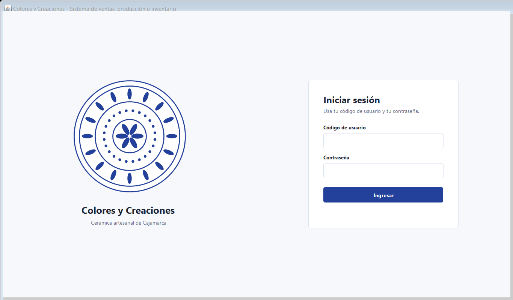
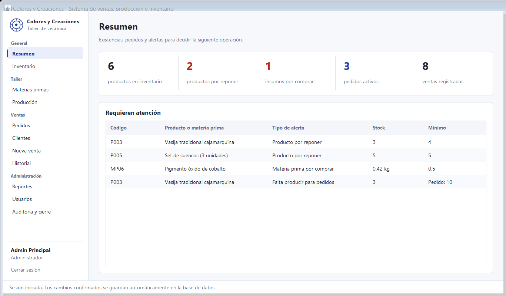
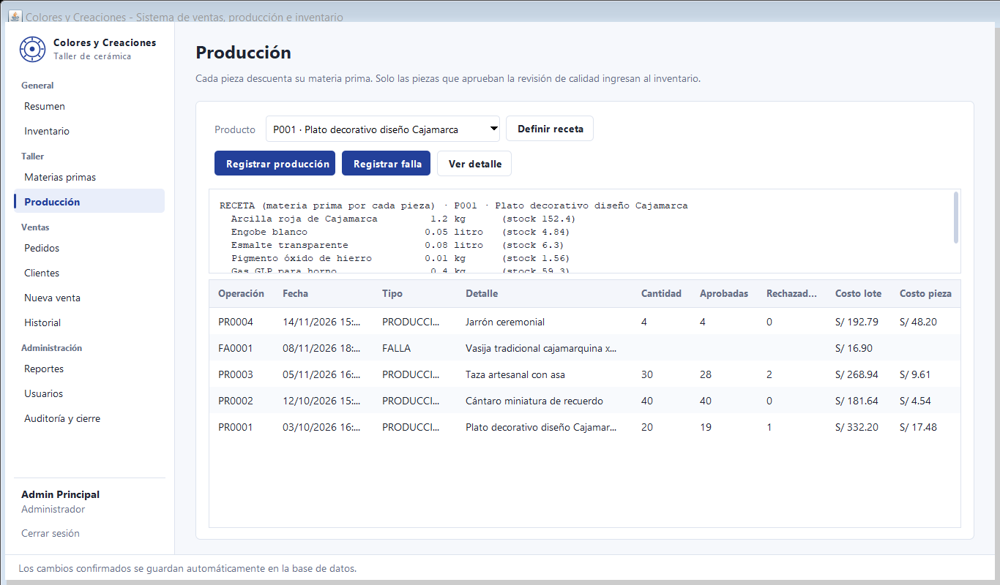
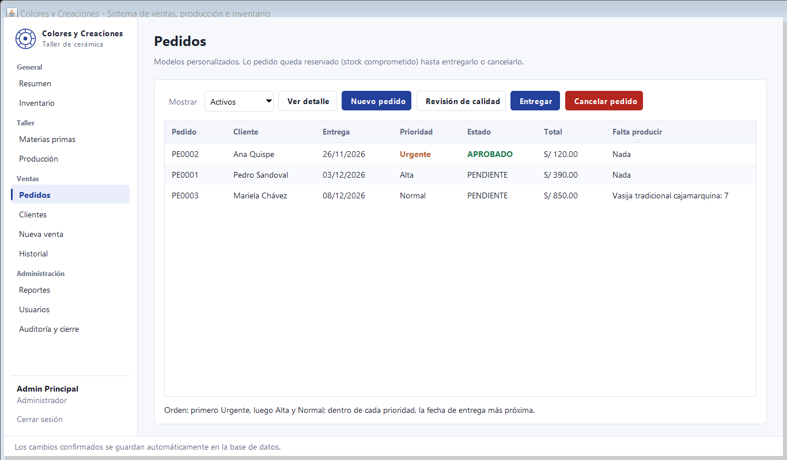
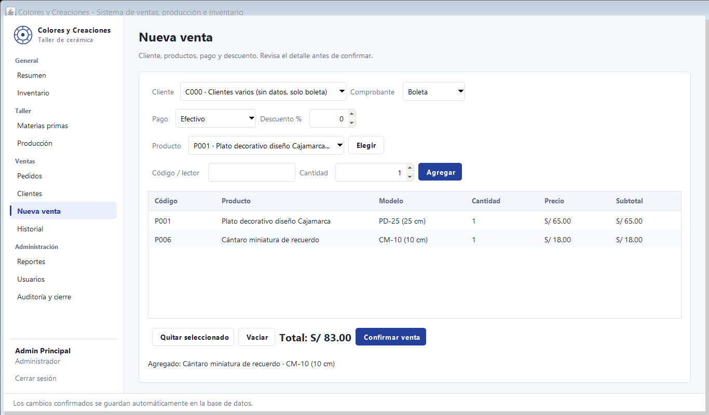

# Manual de usuario — Colores y Creaciones

Guía breve para usar el sistema de ventas, producción e inventario. Para instalarlo, ver
[MANUAL_INSTALACION.md](MANUAL_INSTALACION.md).

## 1. Ingresar

Abrir el sistema (NetBeans → F6, o `ejecutar.cmd`), escribir el código de usuario y la contraseña, y pulsar **Ingresar**.

| Usuario de demostración | Rol | Ve en el menú |
|---|---|---|
| U001 / 1234 | Administrador | Todo |
| U002 / 1234 | Vendedor | Resumen, Inventario, Pedidos, Clientes, Nueva venta, Historial |
| U003 / 1234 | Supervisor de almacén | Resumen, Inventario, Materias primas, Producción, Pedidos, Reportes |

## 2. Resumen

Muestra los productos por reponer, los insumos por comprar, los pedidos activos y una tabla con lo que requiere atención.

## 3. Materias primas

- **Nueva**: código, nombre, unidad, stock inicial, mínimo y costo.
- **Registrar compra**: suma stock y recalcula el costo promedio.
- **Kardex**: entradas, consumos y fallas con su saldo.

## 4. Producción

1. Elegir el producto y pulsar **Definir receta**: cantidad de cada materia prima por pieza.
2. **Registrar producción**: piezas producidas, piezas aprobadas en la revisión de calidad, motivo de rechazo y mano de obra. El sistema descuenta la materia prima y suma al inventario solo las piezas aprobadas.
3. **Registrar falla**: piezas perdidas y motivo; descuenta la materia prima usada.
4. **Ver detalle**: costo del lote y costo por pieza.

## 5. Inventario

Buscar por código, nombre o modelo (el lector de código de barras escribe el código y pulsa Enter). Las columnas
*Comprometido* y *Disponible* indican lo reservado para pedidos. Con permiso de inventario: **Nuevo**, **Editar**,
**Ingresar stock** y **Eliminar**.

## 6. Pedidos personalizados

1. **Nuevo pedido**: cliente, fecha de entrega, prioridad y productos con su diseño. Lo pedido queda reservado.
2. **Revisión de calidad** (supervisor): *Cumple el diseño* o *No cumple* con la observación.
3. **Entregar** (vendedor): elige pago y comprobante; se crea la venta y se abre el PDF.
4. **Cancelar pedido**: libera lo reservado.

## 7. Clientes

**Nuevo cliente**, **Editar**, **Eliminar** (solo sin compras) e **Historial de compras**. La categoría (público general,
coleccionista, decorador de interiores o turista) permite segmentar campañas.

## 8. Nueva venta

1. Elegir cliente (o *Clientes varios* para una boleta sin datos), comprobante, pago y descuento (0 a 30 %).
2. Escanear o escribir el código y pulsar Enter, o elegir el producto y pulsar **Agregar**.
3. Revisar el total y pulsar **Confirmar venta**. Se descuenta el stock y se abre el comprobante PDF.

## 9. Historial, reportes y administración

- **Historial**: ver detalle, volver a generar el PDF, imprimir o enviar por correo.
- **Reportes**: elegir el reporte y el rango de fechas; **Consultar** o **Exportar PDF**.
- **Usuarios** (administrador): registrar usuarios y cambiar roles con la contraseña del rol.
- **Auditoría y cierre** (administrador): quién hizo cada cambio y cuándo; **Cerrar mes** bloquea operaciones con fecha de ese mes.

## 10. Mensajes frecuentes

| Mensaje | Qué hacer |
|---|---|
| Stock insuficiente… hay X comprometidas en pedidos | Vender menos, producir más o revisar los pedidos activos |
| Materia prima insuficiente | Registrar una compra de esa materia prima |
| … no tiene receta | Definir la receta del producto en Producción |
| El pedido debe aprobar la revisión de calidad | El supervisor debe revisar el pedido |
| El mes AAAA-MM tiene la contabilidad cerrada | Ese mes ya fue cerrado; operar con la fecha actual |
| Tu rol no tiene permiso para esta operación | Ingresar con un usuario que tenga ese permiso |
